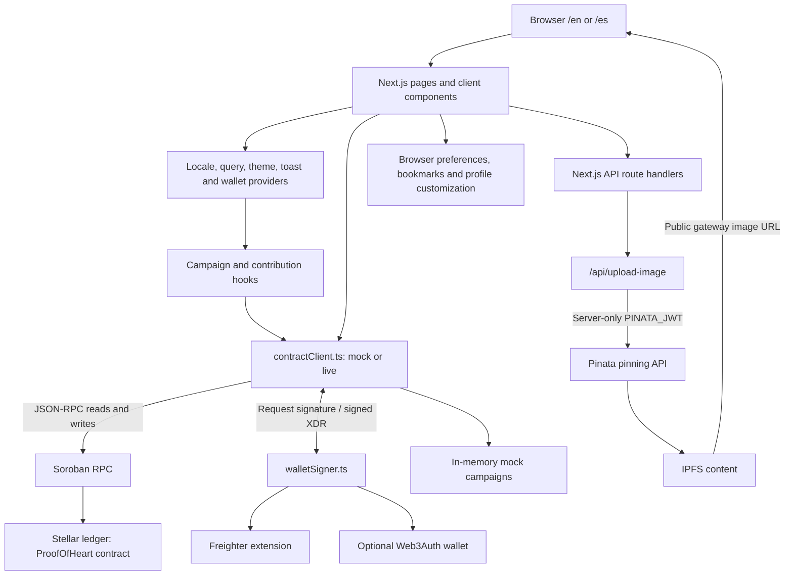
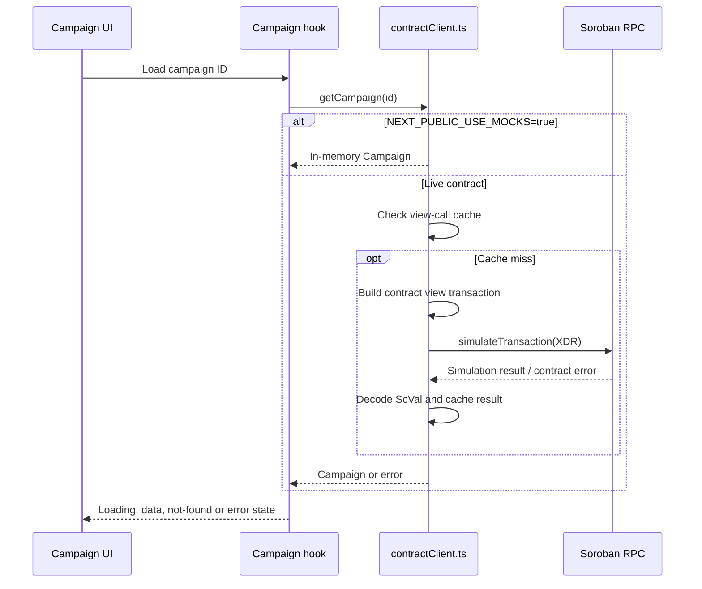
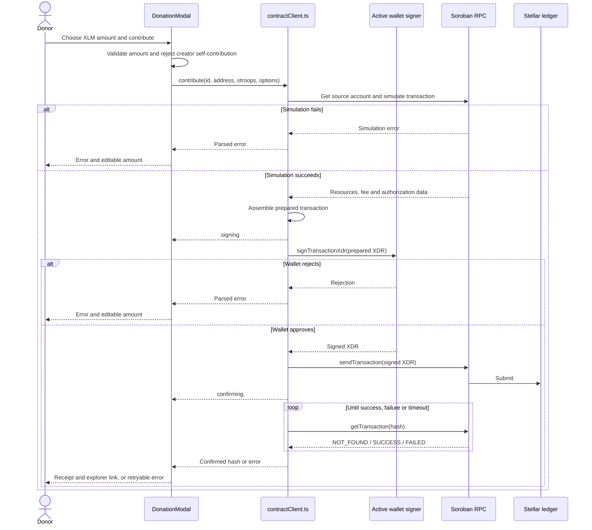
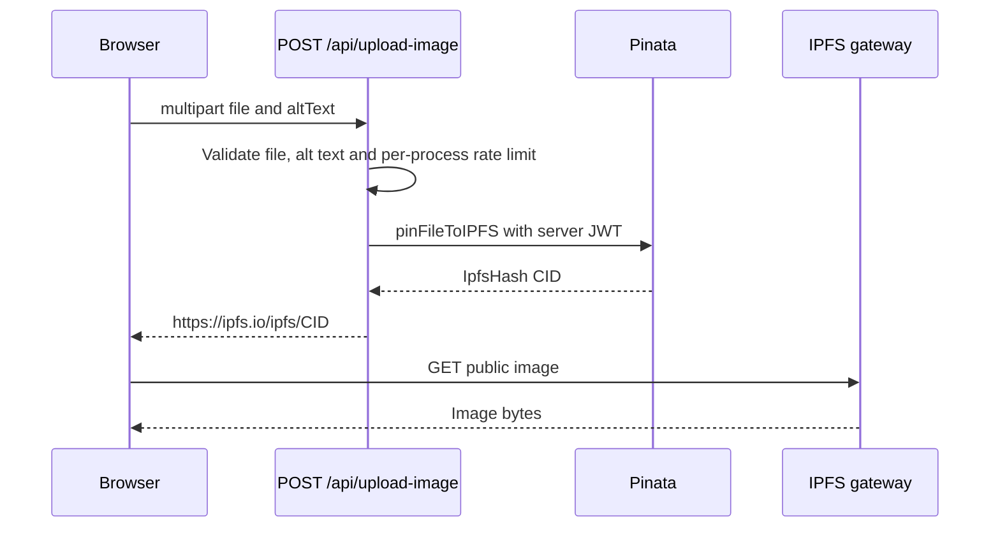

# Architecture and Soroban interaction flow

ProofOfHeart is a Next.js App Router frontend for fundraising on Stellar. Campaign
state and payouts belong to a Soroban contract; React renders that state and asks
the connected wallet to sign writes. The frontend does not receive private keys
from Freighter. An optional Web3Auth wallet uses the same signer interface.

## System overview



The direct component-to-client edge is intentional: `DonationModal` calls
`contribute` directly, while `useContribution` also offers a React Query mutation
with optimistic updates and rollback. Both use the same contract client.

The locale layout supplies the localized root shell. Maintenance, privacy and
terms routes each use `StandaloneRootLayout` because they live outside that
locale segment; each root supplies its own HTML and body elements.

| Layer                 | Current entry points                                                | Responsibility                                                               |
| --------------------- | ------------------------------------------------------------------- | ---------------------------------------------------------------------------- |
| Routing and rendering | `src/app/[locale]/layout.tsx`, `src/i18n/routing.ts`                | English/Spanish routes, server layouts and client providers                  |
| Campaign UI           | `src/app/[locale]/causes/[id]/CauseDetailClient.tsx`                | Campaign details, donation sheet and milestone payout actions                |
| State and queries     | `src/hooks/useCampaign.ts`, `useCampaigns.ts`, `useContribution.ts` | Loading, errors, polling and query invalidation                              |
| Contract adapter      | `src/lib/contractClient.ts`                                         | Mock/live selection, XDR encoding, simulation, submission and decoding       |
| Wallet adapter        | `src/components/WalletContext.tsx`, `src/lib/walletSigner.ts`       | Connected address, network checks and active signer                          |
| Server boundary       | `src/app/api/`                                                      | Image pinning, comments, reports, notifications, observability and RPC proxy |
| Configuration         | `src/lib/envContract.ts`, `envSchema.ts`, `runtimeEnv.ts`           | Variable inventory, validation and client/server scope                       |

## Reading campaign state



View calls use simulation, not a signed ledger submission. The temporary source
account created inside `invokeViewMethod` is only used to construct a view
transaction. Users do not need to connect a wallet to browse campaigns.

`useCampaigns` caches the listing under `["campaigns"]` in React Query, and polls
only while the window is visible. `useCampaign` has its own fetch lifecycle;
do not assume that every hook shares a single React Query cache. The contract
client also caches view results and source accounts, with invalidation on writes.

## Contributing: simulation, signing and confirmation



Amounts use bigint **stroops** (1 XLM = 10,000,000 stroops). Convert input with
`xlmToStroops`; keep floating-point numbers for presentation only. For example,
inside an existing connected-wallet event handler:

```ts
import { contribute } from "@/lib/contractClient";
import { xlmToStroops } from "@/lib/stellarAmount";

const hash = await contribute(campaign.id, publicKey, xlmToStroops("5"), {
  onStatus: ({ phase }) => setPhase(phase),
});
```

Here `campaign`, `publicKey` and `setPhase` come from the caller's component.
Lifecycle phases are `building`, `signing`, `submitting`, `confirming`,
`confirmed` and `failed`. Confirmation defaults to a 90-second timeout, with
increasing poll delays capped at six seconds. Submission acceptance alone does
not mean ledger success. Mock mode emits lifecycle updates without contacting a
wallet or RPC; it cannot validate live authorization or network fees.

Milestone payouts use the same transaction pipeline. `DonationMilestones`
distinguishes fundraising achievements from a contract payout plan. Only an
admin can verify a payout milestone. A creator can claim only when it is verified,
unclaimed, the funding goal is met and the campaign has not been withdrawn.
The contract remains authoritative for authorization and payout calculations.

## Image upload and off-chain state



`src/lib/ipfsUpload.ts` handles Pinata and constructs gateway URLs. `PINATA_JWT`
must stay server-side. Uploading an image does not by itself update a campaign
or send a ledger transaction. Gateway availability and pinning availability are
separate from Stellar confirmation.

Creator profile names, banner previews and social links are browser preferences
stored under a wallet-specific key by `src/lib/creatorProfile.ts`. They are not
published or synced across devices. The verified-campaign badge is derived from
campaign data, never from editable profile fields. Other off-chain features use
local persistence or optional APIs according to their modules; this frontend
does not assume that a single database stores all application state.

`src/app/api/rpc/route.ts` provides a separate JSON-RPC forwarding route using
`MAINNET_RPC_URL` or `TESTNET_RPC_URL`. The contract client constructs its own RPC
server from the public RPC variable; the proxy is **not automatically selected**
by switching `NEXT_PUBLIC_STELLAR_NETWORK`. Keep API keys out of public RPC URLs.

## Local workflow and configuration

1. Use Node.js 22 or later and install with `npm ci`.
2. Copy `.env.example` to `.env.local`.
3. Keep `NEXT_PUBLIC_USE_MOCKS=true` for local UI development, then run `npm run dev`.
4. Open `/en/causes` or `/es/causes`. Mock wallet connection does not require an
   extension or move funds.
5. For live testnet, set mocks to `false`, supply the deployed contract's `C…`
   address, and use a funded testnet wallet on the matching network.

```env
NEXT_PUBLIC_USE_MOCKS=false
# Replace with the actual deployed contract address before running live mode.
NEXT_PUBLIC_CONTRACT_ADDRESS=
NEXT_PUBLIC_SOROBAN_RPC_URL=https://soroban-testnet.stellar.org
NEXT_PUBLIC_STELLAR_NETWORK=testnet
NEXT_PUBLIC_NETWORK_PASSPHRASE=Test SDF Network ; September 2015
```

The canonical names are `NEXT_PUBLIC_CONTRACT_ADDRESS` and
`NEXT_PUBLIC_SOROBAN_RPC_URL`. Legacy `NEXT_PUBLIC_CONTRACT_ID` and
`NEXT_PUBLIC_RPC_URL` are fallbacks. See the
[environment reference](ENVIRONMENT_VARIABLES.md) for validation and optional
settings. A build captures `NEXT_PUBLIC_*` values; rebuild after changing them.

Run `npm run typecheck`, `npm run lint`, the relevant `npm test -- --runInBand`
suites, and `npm run test:e2e` before proposing changes. `npm run build` runs a
production guard that rejects mock mode unless `SKIP_MOCK_CHECK=true` is explicitly
set for a test build. Use real deployment values for production builds.

## Further reading

- [Contributor workflow](../CONTRIBUTING.md)
- [Contract function and type reference](CONTRACT_INTEGRATION.md)
- [API route reference](api.md)
- [Exact amount handling](STELLAR_AMOUNT.md)
- [Environment variables](ENVIRONMENT_VARIABLES.md)
- [Social wallet integration](SOCIAL_LOGIN.md)
- [Deployment playbook](DEPLOYMENT_PLAYBOOK.md)
