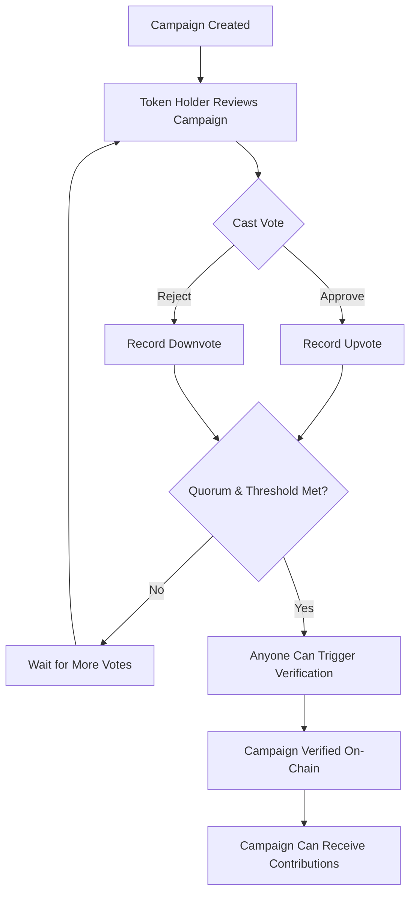

# Multi-Signature Campaign Governance & Voting Protocols

> **Contract version:** `1`  
> **Related contract methods:** `vote_on_campaign`, `verify_campaign_with_votes`, `get_min_votes_quorum`, `get_approval_threshold_bps`

---

## Quick Reference

**Core governance parameters:**
- **Minimum quorum:** Total votes (upvotes + downvotes) must meet threshold
- **Approval threshold:** Percentage of upvotes must exceed configured basis points
- **Token requirement:** Only platform token holders can vote
- **Vote immutability:** Each wallet votes once per campaign (cannot be changed)

**Contract methods:**
```typescript
// View calls (read-only)
getMinVotesQuorum()           // → u32 (e.g., 10)
getApprovalThresholdBps()     // → u32 (e.g., 5000 = 50%)
getApproveVotes(campaignId)   // → u32
getRejectVotes(campaignId)    // → u32
hasVoted(campaignId, voter)   // → bool

// Write calls (requires signature)
voteOnCampaign(campaignId, voter, approve)        // Cast vote
verifyCampaignWithVotes(campaignId)               // Trigger verification
```

**Verification eligibility:**
```typescript
canVerify = (totalVotes >= minQuorum) && 
            ((upvotes / totalVotes) * 10000 >= approvalThresholdBps)
```

---

## Table of Contents

1. [Overview](#1-overview)
2. [Voting Eligibility](#2-voting-eligibility)
3. [Quorum and Approval Thresholds](#3-quorum-and-approval-thresholds)
4. [Voting Process](#4-voting-process)
5. [Vote-Based Verification](#5-vote-based-verification)
6. [Frontend Integration](#6-frontend-integration)
7. [Error Handling](#7-error-handling)
8. [Configuration Parameters](#8-configuration-parameters)
9. [Security Considerations](#9-security-considerations)

---

## 1. Overview

ProofOfHeart implements a **community-driven governance system** where platform token holders collectively validate campaigns through on-chain voting. Rather than relying solely on an admin to verify campaigns, the community can vote to approve or reject campaigns, and verification is triggered automatically once governance criteria are met.

### Governance Flow



### Key Features

- **Token-weighted voting:** Only platform token holders can vote
- **One vote per wallet:** Each address can vote once per campaign
- **Immutable votes:** Votes cannot be changed once cast
- **Public verification:** Anyone can trigger verification once criteria are met
- **Transparent thresholds:** Quorum and approval requirements are on-chain constants

---

## 2. Voting Eligibility

### Token Holder Requirement

To participate in campaign governance, a wallet must hold the **platform token** (`NEXT_PUBLIC_TOKEN_CONTRACT_ID`). The contract checks token balance at the time of voting.

```typescript
// Frontend eligibility check (VotingComponent.tsx)
const isTokenHolder = userTokenBalance > 0;
```

**Contract enforcement:**
- Error code `17` (`NotTokenHolder`) is returned when a non-holder attempts to vote
- Balance must be greater than zero at transaction execution time
- Tokens can be acquired on any Stellar DEX or through platform incentives

### One Vote Per Campaign

Each wallet address can vote **once** per campaign. Subsequent vote attempts are rejected with error code `16` (`AlreadyVoted`).

**Vote immutability:**
- Votes cannot be changed after submission
- No "revote" or "abstain" mechanism exists
- Choose carefully before casting a vote

### Wallet Connection Requirement

Voting requires:
1. Connected Freighter wallet (or Web3Auth social wallet)
2. Sufficient XLM for transaction fees (~0.0001 XLM)
3. Platform token balance > 0
4. Campaign must be in `Pending` status (not yet verified)

---

## 3. Quorum and Approval Thresholds

Two governance parameters control when a campaign can be verified through community votes:

### Minimum Votes Quorum

**Parameter:** `get_min_votes_quorum() → u32`  
**Default value:** `10` (testnet mock)  
**Purpose:** Ensures a minimum level of community participation

The **total number of votes** (upvotes + downvotes) must meet or exceed this threshold before verification can be triggered.

```typescript
// Quorum calculation (VotingComponent.tsx lines 99-102)
const quorumPct = minVotesQuorum && minVotesQuorum > 0
  ? Math.min(100, Math.round((totalVotes / minVotesQuorum) * 100))
  : null;
```

**Example:**
- Quorum = 10
- Current votes: 7 upvotes + 2 downvotes = 9 total
- Status: ❌ Quorum not met (need 1 more vote)

### Approval Threshold

**Parameter:** `get_approval_threshold_bps() → u32`  
**Units:** Basis points (1 basis point = 0.01%)  
**Default value:** `5000` (50.00%)  
**Purpose:** Ensures majority community approval

The **percentage of upvotes** must meet or exceed this threshold. Calculated as:

```
approval_percentage = (upvotes / total_votes) × 100
```

**Example:**
- Threshold = 5000 bps (50%)
- Votes: 8 upvotes, 3 downvotes
- Approval = (8 / 11) × 100 = 72.7% ✅ Threshold met

```typescript
// Approval calculation (VotingComponent.tsx lines 104-110)
const currentApprovalBps = totalVotes > 0 
  ? Math.round((upvotes / totalVotes) * 10000) 
  : 0;
  
const approvalThresholdPct = approvalThresholdBps !== undefined 
  ? approvalThresholdBps / 100 
  : null;
```

### Both Conditions Required

Verification is only possible when **both** quorum AND approval threshold are met:

```typescript
// Verification eligibility (VotingComponent.tsx lines 115-119)
const canVerify = !!onVerifyWithVotes &&
  minVotesQuorum !== undefined &&
  approvalThresholdBps !== undefined &&
  totalVotes >= minVotesQuorum &&
  currentApprovalBps >= approvalThresholdBps;
```

---

## 4. Voting Process

### Step-by-Step Voting Flow

#### 1. Campaign Review

Token holders navigate to a campaign detail page (`/causes/[id]`) to review:
- Campaign title and description
- Funding goal and duration
- Creator wallet address
- Category and revenue-sharing terms
- Current vote counts (if any)

#### 2. Cast Vote

The `VotingComponent` displays two options:

**Approve (Upvote):**
- Signal that the campaign is legitimate
- Contributes toward verification threshold
- Displayed as green checkmark (✓)

**Reject (Downvote):**
- Signal concerns about the campaign
- Counts toward quorum but against approval threshold
- Displayed as red cross (✕)

#### 3. Transaction Signing

```typescript
// Contract call (contractClient.ts lines 2167-2209)
export async function voteOnCampaign(
  campaignId: number,
  voter: string,
  approve: boolean,
  options?: TransactionLifecycleOptions
): Promise<string> {
  const contract = new Contract(CONTRACT_ADDRESS);
  const op = contract.call(
    "vote_on_campaign",
    nativeToScVal(campaignId, { type: "u32" }),
    new Address(voter).toScVal(),
    nativeToScVal(approve, { type: "bool" })
  );
  
  const txResult = await buildAndSubmitTransaction(voter, op, {
    ...options,
    operation: "vote_on_campaign"
  });
  
  return txResult.txHash;
}
```

**Transaction parameters:**
- `campaign_id`: u32 (campaign identifier)
- `voter`: Address (wallet address casting the vote)
- `approve`: bool (`true` for upvote, `false` for downvote)

#### 4. Vote Confirmation

On successful submission:
- Contract emits event: `("campaign_vote_cast", campaign_id, voter)` with `approve: bool`
- Frontend displays confirmation toast
- Vote count updates immediately (optimistic update)
- Button state changes to "Already Voted"

**Vote visibility:**
- Total votes, upvotes and downvotes are public
- Individual voter choices are on-chain but not displayed in the UI
- Vote counts refresh via contract view calls:
  - `get_approve_votes(campaign_id)`
  - `get_reject_votes(campaign_id)`

---

## 5. Vote-Based Verification

### Triggering Verification

Once **both quorum and approval threshold** are met, **anyone** (including non-token-holders) can trigger campaign verification by calling:

```typescript
// Contract call (contractClient.ts lines 2215-2235)
export async function verifyCampaignWithVotes(
  campaignId: number,
  options?: TransactionLifecycleOptions
): Promise<string> {
  const callerAddress = await getSignerAddress();
  const contract = new Contract(CONTRACT_ADDRESS);
  const op = contract.call(
    "verify_campaign_with_votes",
    nativeToScVal(campaignId, { type: "u32" })
  );
  
  const txResult = await buildAndSubmitTransaction(callerAddress, op, {
    ...options,
    operation: "verify_campaign_with_votes"
  });
  
  return txResult.txHash;
}
```

**Who can trigger:**
- Any wallet with sufficient XLM for transaction fees
- No token holding requirement
- No admin privileges required
- Contract validates criteria automatically

**Contract validation:**
1. Check `totalVotes >= get_min_votes_quorum()`
2. Check `(upvotes / totalVotes) × 10000 >= get_approval_threshold_bps()`
3. If both pass: mark campaign as `Verified`
4. If either fails: revert with error code `18` (quorum) or `19` (threshold)

### Automatic UI Integration

The `VotingComponent` displays a **"Verify with Votes"** button when criteria are met:

```typescript
// Verify button (VotingComponent.tsx lines 264-276)
{canVerify && (
  <button
    onClick={onVerifyWithVotes}
    disabled={isVerifying}
    className="w-full min-h-[44px] py-2 px-4 bg-emerald-600 hover:bg-emerald-700 disabled:opacity-60 text-white font-semibold rounded-xl transition-colors text-sm inline-flex items-center justify-center gap-2"
  >
    <AsyncButtonContent
      isPending={isVerifying}
      idleLabel={t("verifyWithVotes")}
      pendingLabel={t("verifying")}
    />
  </button>
)}
```

**Verification status messages:**
- Quorum not met: "Need {count} more votes"
- Threshold not met: "Need {count}% more approval"
- Both met: "Quorum reached" + verify button appears

---

## 6. Frontend Integration

### Component Hierarchy

```
CauseDetailClient.tsx
  │
  ├── Load quorum config on mount
  │   ├── getMinVotesQuorum()
  │   └── getApprovalThresholdBps()
  │
  └── <VotingComponent>
        │
        ├── Display vote counts (upvotes, downvotes, total)
        ├── Render quorum progress bar
        ├── Render approval threshold progress bar
        ├── Handle vote submission
        └── Display verify button (if criteria met)
```

### Data Loading

```typescript
// CauseDetailClient.tsx (lines from architecture)
useEffect(() => {
  if (!campaign) return;
  
  const [quorum, threshold] = await Promise.all([
    getMinVotesQuorum(),
    getApprovalThresholdBps()
  ]);
  
  setMinVotesQuorum(quorum);
  setApprovalThresholdBps(threshold);
}, [campaign]);
```

### Vote Count Queries

The contract provides three view methods for vote tallies:

```typescript
// Contract view calls
export async function getApproveVotes(campaignId: number): Promise<number>;
export async function getRejectVotes(campaignId: number): Promise<number>;
export async function hasVoted(campaignId: number, voter: string): Promise<boolean>;
```

**Usage pattern:**
```typescript
const upvotes = await getApproveVotes(campaignId);
const downvotes = await getRejectVotes(campaignId);
const totalVotes = upvotes + downvotes;
const userHasVoted = await hasVoted(campaignId, userWalletAddress);
```

### Voting UI States

| State                           | UI Behavior                                        |
| ------------------------------- | -------------------------------------------------- |
| Not connected                   | Prompt: "Connect wallet to vote"                   |
| Connected, no tokens            | Prompt: "Token holders only"                       |
| Token holder, already voted     | Buttons disabled, show: "You voted: [Approve/Reject]" |
| Token holder, not voted         | Buttons enabled                                    |
| Transaction pending             | Loading spinner, buttons disabled                  |
| Quorum & threshold met          | "Verify with Votes" button appears                 |

---

## 7. Error Handling

### Vote-Related Errors

| Error Code | Name                    | Cause                                      | User Action                                     |
| ---------- | ----------------------- | ------------------------------------------ | ----------------------------------------------- |
| `16`       | `AlreadyVoted`          | Wallet already voted on this campaign      | No retry; vote is permanent                     |
| `17`       | `NotTokenHolder`        | Wallet has zero platform token balance     | Acquire tokens before voting                    |
| `18`       | `VotingQuorumNotMet`    | Verification attempted before quorum       | Wait for more votes or vote yourself            |
| `19`       | `VotingThresholdNotMet` | Approval percentage below threshold        | Campaign failed community validation            |

**Error display:**
```typescript
// VotingComponent.tsx error handling
const localizeContractError = (message: string) =>
  message.startsWith("ContractErrors.") 
    ? tContractErrors(message) 
    : message;

try {
  await onVote(campaign.id, voteType);
  setLocalVote(voteType);
} catch (error) {
  console.error("Voting failed:", error);
  showError(localizeContractError(
    getAsyncActionErrorMessage(error, parseContractError)
  ));
}
```

### Localized Error Messages

```json
// messages/en.json (ContractErrors namespace)
{
  "AlreadyVoted": "You have already voted on this campaign",
  "NotTokenHolder": "You must hold platform tokens to vote",
  "VotingQuorumNotMet": "Not enough votes have been cast yet",
  "VotingThresholdNotMet": "The approval threshold has not been reached"
}
```

---

## 8. Configuration Parameters

### Contract Constants

| Parameter                   | Type | Default (Testnet) | Purpose                                  | Can Change? |
| --------------------------- | ---- | ----------------- | ---------------------------------------- | ----------- |
| `min_votes_quorum`          | u32  | `10`              | Minimum total votes required             | Admin only  |
| `approval_threshold_bps`    | u32  | `5000` (50%)      | Minimum approval percentage (basis pts)  | Admin only  |

**Basis points (bps) explained:**
- 1 bps = 0.01%
- 100 bps = 1%
- 5000 bps = 50%
- 6000 bps = 60%
- 10000 bps = 100%

### Mainnet Recommendations

For production deployment, consider:

**Quorum:**
- Too low: Vulnerable to spam campaigns with minimal oversight
- Too high: Legitimate campaigns may never reach verification
- **Recommended:** Start with 20-50 votes, adjust based on platform activity

**Approval threshold:**
- 50% (5000 bps): Simple majority
- 60% (6000 bps): Strong majority (recommended for mainnet)
- 67% (6700 bps): Supermajority (very conservative)

**Example mainnet config:**
```rust
// Contract initialization (conceptual)
const MIN_VOTES_QUORUM: u32 = 30;
const APPROVAL_THRESHOLD_BPS: u32 = 6000; // 60%
```

---

## 9. Security Considerations

### Vote Manipulation Prevention

**Sybil resistance:**
- Voting requires platform token ownership
- Acquiring tokens has a cost (market price + gas)
- One vote per wallet prevents simple duplication
- Token requirement creates economic barrier to spam

**Immutable votes:**
- Cannot change vote after submission
- Prevents voting based on current trend
- Encourages thoughtful participation

**Public accountability:**
- All votes are on-chain and auditable
- Vote counts are transparent
- Anyone can verify quorum/threshold calculations

### Edge Cases

**Campaign cancellation:**
- Creator can withdraw a campaign anytime before verification
- Pending votes remain on-chain but become inactive
- No refund mechanism for "wasted" votes (gas cost is minimal)

**Token balance changes:**
- Voting eligibility checked at transaction time
- Balance after voting does not affect vote validity
- Selling tokens after voting does not revoke the vote

**Concurrent verification:**
- Multiple wallets can attempt verification simultaneously
- First successful transaction wins
- Later attempts succeed but are no-ops (already verified)

### Best Practices

**For token holders:**
1. Review campaign details thoroughly before voting
2. Check creator's wallet history on Stellar Explorer
3. Verify funding goal is reasonable for stated purpose
4. Consider community discussion before voting
5. Remember votes are permanent

**For campaign creators:**
1. Provide detailed, transparent campaign descriptions
2. Link to external proof (social media, website)
3. Set realistic funding goals
4. Engage with community questions
5. Understand that verification requires community approval

**For platform operators:**
1. Monitor vote patterns for suspicious activity
2. Adjust quorum/threshold based on platform growth
3. Provide educational resources about governance
4. Consider implementing off-chain discussion forums
5. Maintain transparency in threshold changes

---

## Summary

ProofOfHeart's governance system empowers the community to validate campaigns through token-weighted voting. By requiring both a minimum participation threshold (quorum) and a minimum approval percentage (threshold), the platform ensures that only campaigns with broad community support can be verified and receive contributions.

**Key points:**
- ✅ Token holders vote approve/reject on campaigns
- ✅ Each wallet votes once per campaign (immutable)
- ✅ Quorum + approval threshold must both be met
- ✅ Anyone can trigger verification once criteria are met
- ✅ All parameters and votes are on-chain and transparent

**Related documentation:**
- [Contract Integration](./CONTRACT_INTEGRATION.md) — Frontend ↔ contract data flow
- [Architecture](./architecture.md) — System overview and component hierarchy
- [Contract Repository](https://github.com/Iris-IV/ProofOfHeart-stellar) — Rust smart contract source

For questions or issues with the governance system, see the [troubleshooting guide](./troubleshooting.md) or open an issue on GitHub.
